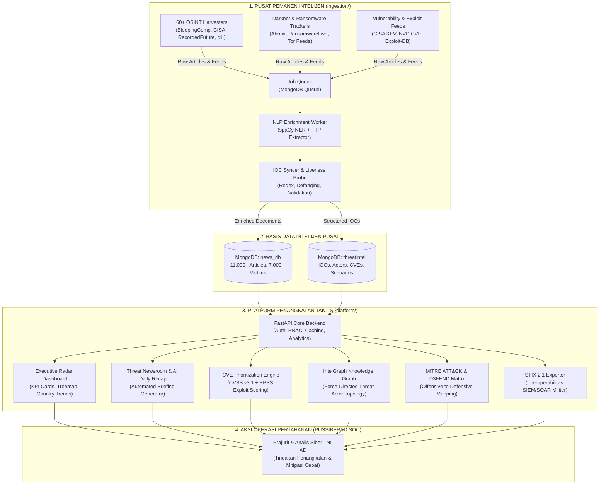

# CTI Nexus 🛡️
### Autonomous Cyber Threat Intelligence & National Defensive Operations Platform
**Submisi Resmi Kartika Cyber Hackathon 2026 — Kategori Penangkalan (Defensive Shield)**  
*Diselenggarakan oleh Pusat Siber TNI AD (PUSSIBERAD) × CODEPOLITAN*

[](https://python.org)
[](https://fastapi.tiangolo.com)
[](https://mongodb.com)
[](https://spacy.io)
[](https://attack.mitre.org)
[](https://d3fend.mitre.org)
[](https://oasis-open.github.io/cti-documentation/)
[](#arsitektur-sistem)

---

## 📌 Ringkasan Eksekutif & Relevansi TNI AD

Dalam doktrin pertahanan siber modern, **"Penangkalan" (Defensive Shield)** tidak dapat dibangun di atas kepasifan atau data statis. Ancaman siber terhadap kedaulatan nasional—mulai dari serangan *Advanced Persistent Threat* (APT) negara asing, kampanye *Ransomware* terhadap infrastruktur kritis, hingga eksploitasi *Zero-Day*—memerlukan sistem radar siber otonom yang bekerja 24/7.

**CTI Nexus** adalah platform *Cyber Threat Intelligence* (CTI) berdaulat (*sovereign-grade*) yang dirancang khusus untuk memenuhi standar operasi taktis dan strategis Pusat Siber TNI AD (**PUSSIBERAD**):
1. **Kedaulatan Data & Air-Gappable**: Seluruh pipeline dapat di-deploy secara *on-premises* atau *air-gapped* tanpa dependensi layanan intelijen komersial asing.
2. **Koleksi OSINT & Darkweb Skala Penuh**: Mengintegrasikan lebih dari 60 *crawler* independen yang menyaring intelijen dari situs vendor global, darkweb forum, CISA KEV, hingga kebocoran ransomware secara real-time.
3. **Penyelarasan Taktis MITRE D3FEND**: Tidak hanya mendeteksi taktik musuh (ATT&CK), CTI Nexus memetakan matriks penangkalan defensif (MITRE D3FEND) yang memberikan rekomendasi tindakan teknis langsung bagi analis SOC.

---

## 🏗️ Arsitektur Sistem (End-to-End Pipeline)

CTI Nexus dibangun menggunakan arsitektur **Monorepo** yang memisahkan subsistem pemanen intelijen (*Ingestion Engine*) dengan subsistem analisis dan visualisasi taktis (*Defense Platform*), terhubung melalui basis data MongoDB berkinerja tinggi.



---

## 📁 Struktur Direktori Repositori (Monorepo)

```text
cti-nexus/
├── platform/                          # Sub-Sistem 1: Core Platform & Defense Interface
│   ├── app/                           # FastAPI Backend Architecture
│   │   ├── routers/                   # Endpoint API (Articles, CVE, IOC, Graph, D3FEND, Auth)
│   │   ├── models/                    # Pydantic Schemas & Data Contracts
│   │   ├── services/                  # Business Logic, Scoring, STIX 2.1 Exporter
│   │   └── main.py                    # Server Lifecycle & Middleware Mounts
│   ├── static/                        # Frontend Assets (Tailwind/CSS, Chart.js, Vis.js)
│   │   └── intelgraph/                # Production SPA bundle untuk IntelGraph Topology
│   ├── templates/                     # Modern Jinja2 Server-Side Rendered Templates
│   ├── scripts/                       # Database Management & Migration Tooling
│   ├── run.py                         # Platform Entrypoint
│   ├── requirements.txt               # Platform Python Dependencies
│   └── .env.template                  # Platform Environment Config Template
│
├── ingestion/                         # Sub-Sistem 2: Autonomous OSINT Harvester Engine
│   ├── modules/                       # NLP Extraction, JobQueue, & Validator Logic
│   │   ├── nlp.py                     # spaCy Named Entity Recognition & TTP Tagging
│   │   ├── iocExtractor.py            # High-performance IOC Pattern Recognizer
│   │   ├── dbMongo.py                 # Ingestion Database Adapter
│   │   └── jobQueue.py                # Asynchronous Ingestion Task Queue
│   ├── nlp_worker.py                  # Daemon pemroses antrean artikel & ekstraksi entitas
│   ├── iocSyncer.py                   # Daemon sinkronisasi & verifikasi liveness indikator
│   ├── config/                        # Ingestion Configuration Templates
│   ├── requirements.txt               # Ingestion Worker Dependencies
│   ├── FIRST_RUN.md                   # Panduan Operasional Pipeline Ingestion
│   └── *Threat.py                     # 60+ Skrip OSINT Scraper Independen
│
├── docs/                              # Dokumentasi Arsitektur & Panduan Operasional
├── run.py                             # Root Entrypoint Wrapper (Auto-resolving paths)
├── .gitignore                         # Strict Defense-Grade Git Hygiene
└── README.md                          # Dokumentasi Induk Submisi Hackathon
```

---

## 🚀 Fitur Unggulan (Penangkalan / Defensive Shield)

### 1. Executive Cyber Radar & Threat Treemap
Memberikan visibilitas instan kepada pimpinan perwira dan analis mengenai lanskap ancaman siber yang sedang berlangsung: volume insiden, tren korban ransomware berdasarkan sektor industri, dan persebaran geografis negara target.

### 2. IntelGraph: Visualisasi Topologi Ancaman (Force-Directed Graph)
Menghubungkan titik-titik intelijen secara interaktif antara **Threat Actors $\rightarrow$ Vulnerabilities (CVE) $\rightarrow$ IOCs $\rightarrow$ Target Sektor**. Memungkinkan analis melacak alur kampanye siber lawan secara komprehensif.

### 3. Matriks MITRE D3FEND (Aksi Penangkalan Nyata)
Bukan sekadar mencatat bagaimana musuh menyerang (ATT&CK), CTI Nexus memetakan teknik serangan ke tindakan mitigasi dan penangkalan aktif berdasarkan standar **MITRE D3FEND** (misal: *File Hashing, Decoy Environment, Network Traffic Filtering, Inbound Traffic Authentication*).

### 4. Triase Kerentanan Otomatis (CVSS v3.1 + EPSS)
Memfilter ratusan kerentanan harian menjadi daftar prioritas tindakan menggunakan skor gabungan keparahan (CVSS) dan probabilitas eksploitasi di dunia nyata (*Exploit Prediction Scoring System / EPSS*), disinkronkan langsung dengan basis data **CISA KEV** (*Known Exploited Vulnerabilities*).

### 5. Interoperabilitas STIX 2.1
Mendukung ekspor data intelijen ancaman ke format standar internasional OASIS STIX 2.1, siap diintegrasikan secara mulus ke SIEM, SOAR, atau Firewall pertahanan TNI AD.

---

## ⚡ Panduan Instalasi & Menjalankan

### Persyaratan Sistem
- Python 3.11+
- MongoDB 6.0+
- OS: Linux (Ubuntu/Debian/RHEL) atau macOS

### 1. Menjalankan Platform Web CTI Nexus (`platform/`)

```bash
# Clone repositori
git clone https://github.com/IchsanJunaedi/cti-nexus.git
cd cti-nexus

# Buat virtual environment
python3 -m venv .venv
source .venv/bin/activate

# Install dependensi platform
pip install -r platform/requirements.txt

# Salin konfigurasi environment
cp platform/.env.template platform/.env
# Sesuaikan MONGO_HOST, MONGO_PORT, dan JWT_SECRET di platform/.env

# Jalankan platform (bisa dari root atau dari folder platform)
python run.py
```
Akses platform melalui browser di: `https://localhost:5443`

---

### 2. Menjalankan Ingestion Engine & NLP Worker (`ingestion/`)

```bash
cd ingestion

# Install dependensi ingestion & model spaCy
pip install -r requirements.txt
python3 -m spacy download en_core_web_sm

# Konfigurasi koneksi
cp config/config.yml.template config/config.yml
# Isi credential MongoDB pada config/config.yml

# Jalankan daemon NLP Worker (pemroses antrean artikel)
python3 nlp_worker.py

# Menjalankan salah satu harvester (contoh: CISA Alert Harvester)
python3 cisaThreat.py
```

---

## 🌐 Live Demo & Akses Pengujian

Bagi dewan juri yang ingin menguji prototipe secara langsung, kami menyediakan instance server yang aktif dan terhubung dengan data real-time:

- **Public URL**: [https://tap-alfred-dated-luck.trycloudflare.com](https://tap-alfred-dated-luck.trycloudflare.com)
- **Akun Akses Pengujian Juri**:
  - *Username*: `demo@cti-nexus.local`
  - *Password*: `KartikaCyber2026!`
  *(Catatan: Anda juga dapat mendaftar akun baru langsung di halaman login)*

---

## 👥 Profil Tim Pengembang (Aegis Nexus)

- **Ketua Tim & Pengembang Utama**: **Ichsan Junaedi** (Universitas / Tim Aegis Nexus)
- **Kategori Lomba**: Penangkalan (Defensive Shield)
- **Kompetisi**: Kartika Cyber Hackathon 2026 (Pusat Siber TNI AD × CODEPOLITAN)

---

## 📄 Lisensi & Hak Cipta
Hak Cipta © 2026 Tim Aegis Nexus. Dikembangkan khusus untuk Submisi Resmi Kartika Cyber Hackathon 2026, Pusat Siber TNI AD.
