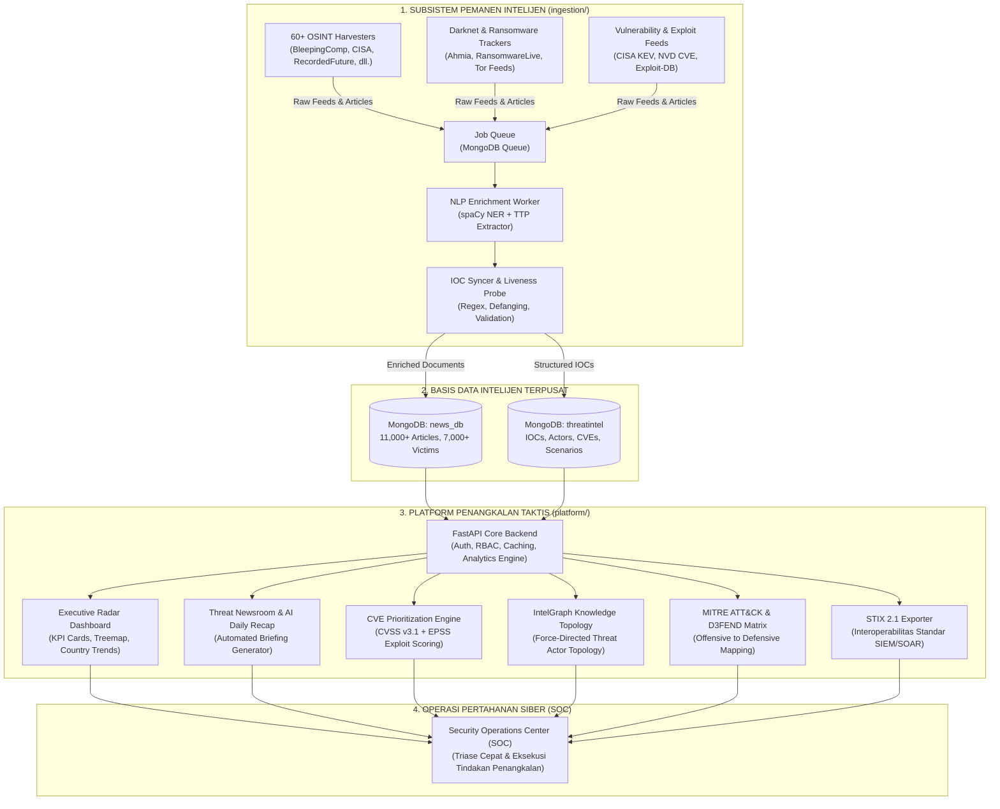

# CTI Nexus 🛡️
### Autonomous Cyber Threat Intelligence & Defensive Operations Platform
**A Next-Generation Defensive Shield Ecosystem for Proactive Threat Detection and Neutralization**

[](https://python.org)
[](https://fastapi.tiangolo.com)
[](https://mongodb.com)
[](https://spacy.io)
[](https://attack.mitre.org)
[](https://d3fend.mitre.org)
[](https://oasis-open.github.io/cti-documentation/)
[](#arsitektur-sistem)

---

## 📌 Ringkasan Eksekutif: Transformasi Paradigma Pertahanan Siber

Dalam lanskap ancaman modern, pertahanan siber yang tangguh (**Defensive Shield**) tidak dapat lagi mengandalkan respons pasif setelah insiden terjadi. Ancaman persisten seperti kampanye *Advanced Persistent Threat* (APT), ransomware terdistribusi, dan eksploitasi kerentanan *Zero-Day* memerlukan **arsitektur penangkalan proaktif** yang mampu mengantisipasi serangan sebelum menembus perimeter.

**CTI Nexus** adalah platform *Cyber Threat Intelligence* (CTI) otonom dan berdaulat (*sovereign-grade*) yang dirancang untuk menjembatani jurang pemisah antara pengumpulan data intelijen mentah dengan eksekusi penangkalan defensif di lapangan:
1. **Otonom & Self-Sovereign**: Seluruh pipeline dirancang untuk dapat beroperasi secara mandiri (*self-hosted* atau *air-gapped*), memproses ribuan data intelijen tanpa ketergantungan pada vendor intelijen komersial pihak ketiga.
2. **Koleksi Multi-Source Skala Penuh**: Mengoperasikan lebih dari 60 *harvester* independen yang menyaring intelijen dari situs riset keamanan global, darknet feeds, radar CISA KEV, hingga kebocoran ransomware secara real-time.
3. **Penyelarasan Taktis MITRE D3FEND**: Tidak hanya memetakan teknik penyerang (ATT&CK), CTI Nexus secara otomatis menghubungkan temuan intelijen dengan matriks penangkalan defensif (**MITRE D3FEND**) untuk memberikan rekomendasi tindakan mitigasi langsung bagi analis SOC.

---

## 🏗️ Arsitektur Sistem (End-to-End Pipeline)

CTI Nexus dibangun menggunakan arsitektur **Monorepo terpadu** yang memisahkan subsistem pengumpulan intelijen (*Ingestion Engine*) dengan subsistem analisis dan visualisasi taktis (*Defense Platform*), terhubung melalui basis data MongoDB berkecepatan tinggi.



---

## 📁 Struktur Direktori Repositori (Monorepo)

```text
cti-nexus/
├── platform/                          # Sub-Sistem 1: Core Platform & Defense Interface
│   ├── app/                           # FastAPI Backend Architecture
│   │   ├── routers/                   # Endpoint API (Articles, CVE, IOC, Graph, D3FEND, Auth)
│   │   ├── models/                    # Pydantic Schemas & Data Contracts
│   │   ├── services/                  # Business Logic, Scoring, STIX 2.1 Exporter
│   │   └── main.py                    # Server Lifecycle & Middleware Mounts
│   ├── static/                        # Frontend Assets (Tailwind/CSS, Chart.js, Vis.js)
│   │   └── intelgraph/                # Production SPA bundle untuk IntelGraph Topology
│   ├── templates/                     # Modern Jinja2 Server-Side Rendered Templates
│   ├── scripts/                       # Database Management & Migration Tooling
│   ├── run.py                         # Platform Entrypoint
│   ├── requirements.txt               # Platform Python Dependencies
│   └── .env.template                  # Platform Environment Config Template
│
├── ingestion/                         # Sub-Sistem 2: Autonomous OSINT Harvester Engine
│   ├── modules/                       # NLP Extraction, JobQueue, & Validator Logic
│   │   ├── nlp.py                     # spaCy Named Entity Recognition & TTP Tagging
│   │   ├── iocExtractor.py            # High-performance IOC Pattern Recognizer
│   │   ├── dbMongo.py                 # Ingestion Database Adapter
│   │   └── jobQueue.py                # Asynchronous Ingestion Task Queue
│   ├── nlp_worker.py                  # Daemon pemroses antrean artikel & ekstraksi entitas
│   ├── iocSyncer.py                   # Daemon sinkronisasi & verifikasi liveness indikator
│   ├── config/                        # Ingestion Configuration Templates
│   ├── requirements.txt               # Ingestion Worker Dependencies
│   ├── FIRST_RUN.md                   # Panduan Operasional Pipeline Ingestion
│   └── *Threat.py                     # 60+ Skrip OSINT Scraper Independen
│
├── docs/                              # Dokumentasi Arsitektur & Panduan Operasional
├── run.py                             # Root Entrypoint Wrapper (Auto-resolving paths)
├── .gitignore                         # Strict Defense-Grade Git Hygiene
└── README.md                          # Dokumentasi Induk Repositori
```

---

## 🚀 Fitur Unggulan (Defensive Shield Capabilities)

### 1. Executive Cyber Radar & Threat Treemap
Memberikan visibilitas instan kepada pengambil keputusan dan analis mengenai lanskap ancaman yang sedang berlangsung: volume insiden, tren korban ransomware berdasarkan sektor industri, dan persebaran geografis target serangan.

### 2. IntelGraph: Visualisasi Topologi Ancaman (Force-Directed Graph)
Menghubungkan entitas intelijen secara dinamis antara **Threat Actors $\rightarrow$ Vulnerabilities (CVE) $\rightarrow$ IOCs $\rightarrow$ Target Sektor**. Memungkinkan analis melacak alur kampanye siber dan infrastruktur lawan secara visual dan mendalam.

### 3. Matriks Penangkalan MITRE D3FEND
Bukan sekadar mencatat bagaimana musuh menyerang (ATT&CK), CTI Nexus memetakan teknik serangan ke tindakan mitigasi dan penangkalan aktif berdasarkan standar **MITRE D3FEND** (misal: *File Hashing, Decoy Environment, Network Traffic Filtering, Inbound Traffic Authentication*).

### 4. Triase Kerentanan Otomatis (CVSS v3.1 + EPSS)
Memfilter ratusan kerentanan harian menjadi daftar prioritas tindakan menggunakan skor gabungan keparahan (CVSS) dan probabilitas eksploitasi di dunia nyata (*Exploit Prediction Scoring System / EPSS*), disinkronkan langsung dengan basis data **CISA KEV** (*Known Exploited Vulnerabilities*).

### 5. Interoperabilitas Standar OASIS STIX 2.1
Mendukung ekspor data intelijen ancaman ke format standar internasional OASIS STIX 2.1, siap diintegrasikan secara instan ke SIEM, SOAR, atau perimeter Firewall organisasi.

---

## ⚡ Panduan Instalasi & Menjalankan

### Persyaratan Sistem
- Python 3.11+
- MongoDB 6.0+
- OS: Linux (Ubuntu/Debian/RHEL) atau macOS

### 1. Menjalankan Platform Web CTI Nexus (`platform/`)

```bash
# Clone repositori
git clone https://github.com/IchsanJunaedi/cti-nexus.git
cd cti-nexus

# Buat virtual environment
python3 -m venv .venv
source .venv/bin/activate

# Install dependensi platform
pip install -r platform/requirements.txt

# Salin konfigurasi environment
cp platform/.env.template platform/.env
# Sesuaikan MONGO_HOST, MONGO_PORT, dan JWT_SECRET di platform/.env

# Jalankan platform (bisa dari root atau dari folder platform)
python run.py
```
Akses platform melalui browser di: `https://localhost:5443`

---

### 2. Menjalankan Ingestion Engine & NLP Worker (`ingestion/`)

```bash
cd ingestion

# Install dependensi ingestion & model spaCy
pip install -r requirements.txt
python3 -m spacy download en_core_web_sm

# Konfigurasi koneksi
cp config/config.yml.template config/config.yml
# Isi credential MongoDB pada config/config.yml

# Jalankan daemon NLP Worker (pemroses antrean artikel)
python3 nlp_worker.py

# Menjalankan salah satu harvester (contoh: CISA Alert Harvester)
python3 cisaThreat.py
```

---

## 🌐 Live Demo & Akses Pengujian

Bagi evaluator dan peninjau yang ingin menguji prototipe secara langsung, instance demo aktif yang terhubung dengan data real-time dapat diakses pada:

- **Public URL**: [https://tap-alfred-dated-luck.trycloudflare.com](https://tap-alfred-dated-luck.trycloudflare.com)
- **Akun Akses Pengujian**:
  - *Username*: `demo@cti-nexus.local`
  - *Password*: `KartikaCyber2026!`
  *(Catatan: Pendaftaran akun baru juga dapat dilakukan langsung di halaman login)*

---

## 👥 Profil Pengembang & Tim

- **Tim Pengembang**: **Aegis Nexus**
- **Lead Developer**: **Ichsan Junaedi**
- **Fokus Riset**: Cyber Threat Intelligence, Threat Actor Graph Modeling, and Proactive Cyber Defense Architecture

---

## 📄 Lisensi
Dikembangkan oleh Tim Aegis Nexus untuk kategori Penangkalan (Defensive Shield) - Kartika Cyber Hackathon 2026.
