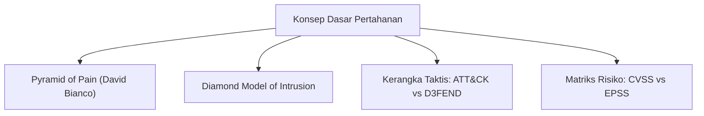

# BUKU PANDUAN TEKNIS & MASTER STUDY GUIDE
## CTI NEXUS: AUTONOMOUS CYBER THREAT INTELLIGENCE & DEFENSIVE SHIELD PLATFORM
**Dokumen Pembekalan Tim & Acuan Presentasi Teknis Kartika Cyber Hackathon 2026**  
*Tim Pengembang: Aegis Nexus | Kategori: Penangkalan (Defensive Shield)*

---

## DAFTAR ISI
1. [BAB 1: Esensi & Landasan Teori CTI (Untuk Apa CTI Nexus Dibuat?)](#bab-1-esensi--landasan-teori-cti)
2. [BAB 2: Arsitektur Sistem & Spesifikasi Infrastruktur](#bab-2-arsitektur-sistem--spesifikasi-infrastruktur)
3. [BAB 3: Skema Basis Data & Model Data MongoDB](#bab-3-skema-basis-data--model-data-mongodb)
4. [BAB 4: Deep-Dive Fitur Unggulan (The Defensive Shield)](#bab-4-deep-dive-fitur-unggulan)
5. [BAB 5: Silabus Materi Pokok yang Wajib Dikuasai Anggota Tim](#bab-5-silabus-materi-pokok)
6. [BAB 6: Bank Pertanyaan & Strategi Menjawab Pertanyaan Juri](#bab-6-bank-pertanyaan--strategi-menjawab-juri)

---

## BAB 1: ESENSI & LANDASAN TEORI CTI

### 1.1 Masalah Fundamental Pertahanan Siber Saat Ini
Mayoritas Security Operations Center (SOC) dan tim pertahanan siber terjebak dalam paradigma **Reaktif**:
- Firewall dan SIEM hanya membunyikan alarm *setelah* malware menyentuh endpoint atau lalu lintas jaringan mencurigakan terdeteksi.
- Analis mengalami *alert fatigue* (kelelahan meninjau ribuan notifikasi per hari yang 95%-nya adalah false positive).
- Tindakan pertahanan dilakukan tanpa konteks: "Siapa aktor di balik serangan ini? Apakah ini kampanye global terorganisir atau pemindaian acak? Celah apa yang akan mereka serang berikutnya?"

### 1.2 Mengapa CTI Nexus Menjawab Kategori "Penangkalan" (Defensive Shield)?
CTI Nexus mengubah paradigma dari **Reaktif $\rightarrow$ Proaktif**:
1. **Early Warning Radar**: Mendeteksi rencana serangan musuh, tren eksploitasi zero-day, dan diskusi darkweb *sebelum* penyerang melancarkan aksinya ke infrastruktur lokal.
2. **Dari Informasi ke Aksi (Actionable Defense)**: Platform intelijen tradisional (seperti MISP standar) hanya mengumpulkan IOC dan mencatat taktik lawan (ATT&CK). CTI Nexus melangkah lebih jauh dengan memetakan temuan intelijen langsung ke **MITRE D3FEND** (tindakan teknis pertahanan seperti *Inbound Traffic Filtering, Decoy System, Process Hashing, Credential Rotation*).
3. **Kedaulatan Data (Sovereign Intelligence)**: Dibangun untuk beroperasi mandiri (*self-hosted* atau *air-gapped*), sehingga institusi militer dan pertahanan tidak perlu membocorkan log internal ke vendor cloud intelijen asing.

### 1.3 Siklus Intelijen Ancaman Siber (CTI Lifecycle)
CTI Nexus menerapkan standar siklus intelijen intelijen internasional:
```
Planning/Direction ──> Collection ──> Processing ──> Analysis ──> Dissemination ──> Feedback
      (PIRs)          (60+ Scrapers)  (NLP/NER/Queue) (Graph/D3FEND)   (STIX 2.1/UI)   (SOC Analyst)
```
- **Planning & Direction**: Berdasarkan *Priority Intelligence Requirements* (PIR).
- **Collection**: Pengumpulan otomatis dari 60+ sumber OSINT, vendor blog, radar CISA KEV, dan darkweb.
- **Processing**: Normalisasi teks, pembersihan tag HTML, deduplikasi dokumen via hash, dan deduplikasi URL.
- **Analysis**: Ekstraksi entitas TTP, CVE, aktor ancaman, dan skor probabilitas eksploitasi (EPSS).
- **Dissemination**: Visualisasi dashboard interaktif, ekspor paket OASIS STIX 2.1, dan notifikasi email briefing.

---

## BAB 2: ARSITEKTUR SISTEM & SPESIFIKASI INFRASTRUKTUR

CTI Nexus dirancang menggunakan arsitektur **Monorepo Terpisah (Decoupled Engines)** yang terdiri dari 2 subsistem utama:

```
┌────────────────────────────────────────────────────────────────────────────────────────┐
│                                   CTI NEXUS MONOREPO                                   │
├─────────────────────────────────────────┬──────────────────────────────────────────────┤
│ 1. INGESTION ENGINE (ingestion/)        │ 2. DEFENSE PLATFORM (platform/)              │
│ - 60+ Autonomous OSINT Scrapers         │ - FastAPI Asynchronous ASGI Core             │
│ - MongoDB Job Queue Producer            │ - Jinja2 Responsive Dark-Mode UI             │
│ - spaCy NLP Multi-Worker Consumer       │ - IntelGraph Force-Directed Topology Engine  │
│ - iocSyncer & Liveness Health Daemons   │ - STIX 2.1 Serialization & API Routers       │
└─────────────────────────────────────────┴──────────────────────────────────────────────┘
                                          │
                                          ▼
                         MONGODB CLUSTER (Port 27017)
                 ├── Database: news_db (11,900+ Articles, IOCs)
                 └── Database: threatintel (CVE, Actors, Scenarios)
```

### 2.1 Spesifikasi Teknis Komponen

| Komponen | Teknologi | Peran & Detail Operasional |
| :--- | :--- | :--- |
| **Backend Core** | Python 3.11, FastAPI, Uvicorn | Menangani routing asynchronous, validasi schema Pydantic, autentikasi JWT token (cookie/bearer), dan rendering SSR. |
| **Database** | MongoDB 6.0+ | Document store terdistribusi untuk menyimpan artikel semi-terstruktur, graf entitas, relasi TTP, dan log audit. |
| **NLP Engine** | spaCy (`en_core_web_sm`), Regex | Ekstraksi entitas otomatis (NER) untuk mendeteksi nama APT, CVE, malware family, dan IOC (IPv4, CIDR, Domain, URL, MD5/SHA256). |
| **Frontend UI** | HTML5, Tailwind CSS, Chart.js, Vis.js | Antarmuka pengguna modern dengan tema gelap taktis militer (*tactical dark mode*), responsif tanpa framework berat. |
| **Topology Engine** | IntelGraph (React + Force Graph bundle) | Graf visual interaktif yang merender relasi multi-hop antar entitas intelijen siber secara real-time. |
| **Security Layer** | SSL/TLS (HTTPS Port 5443), Argon2 / Bcrypt | Komunikasi terenkripsi penuh dengan proteksi brute-force, rate limiting, dan role-based access control (Admin, Analyst, Viewer). |

### 2.2 Alur Data Ingestion (Pipeline Harvesting)
1. **Scraping**: Puluhan script harvester (`bleepcompThreat.py`, `cisaThreat.py`, `ransomwareLiveThreat.py`, dll.) berjalan via scheduler/cron.
2. **Deduplikasi**: Pengecekan riwayat crawl menggunakan `modules/offsetStore.py` agar artikel yang sama tidak diproses ulang.
3. **Queueing**: Artikel mentah dimasukkan ke koleksi antrean kerja (`jobQueue`) di MongoDB.
4. **NLP Worker (`nlp_worker.py`)**: Daemon worker mengambil tugas dari queue, menjalankan tokenisasi dan model spaCy, mengekstrak TTP MITRE, mendeteksi CVE, dan menandai aktor ancaman.
5. **IOC Syncer (`iocSyncer.py`)**: Mengekstrak indikator teknis (IP, domain, hash), melakukan *defanging* (mengubah `http` jadi `hxxp` agar aman), dan menjalankan uji *liveness* (apakah infrastruktur musuh masih aktif).
6. **Storage**: Data yang telah diperkaya (*enriched*) disimpan ke dalam basis data utama (`news_db.articles` & `news_db.iocs`).

---

## BAB 3: SKEMA BASIS DATA & MODEL DATA MONGODB

Sistem menggunakan 2 basis data utama dalam kluster MongoDB:
1. `news_db`: Menyimpan artikel feeds, IOC hasil ekstraksi, dan akun pengguna.
2. `threatintel`: Menyimpan intelijen terstruktur (CVE, Threat Actors, Ransomware victims, dan skenario serangan).

### 3.1 Skema Koleksi `news_db.articles`
Menyimpan seluruh artikel berita dan peringatan siber global yang telah diperkaya:
```json
{
  "_id": "ObjectId('66e8f1...')",
  "title": "APT29 Deploys New Stealth Malware Targeting Defense Sector",
  "source": "BleepingComputer",
  "url": "https://www.bleepingcomputer.com/news/security/...",
  "published_at": "2026-11-12T14:30:00Z",
  "raw_content": "Pusat analisis intelijen melaporkan aktivitas...",
  "summary": "Analisis teknis aktivitas spionase APT29 menggunakan backdoor baru...",
  "ttp_tags": [
    "T1059.001",
    "T1566.001",
    "T1071.001"
  ],
  "cve_tags": [
    "CVE-2026-24090"
  ],
  "threat_actors": [
    "APT29",
    "Cozy Bear"
  ],
  "targeted_sectors": [
    "Defense",
    "Government"
  ],
  "targeted_countries": [
    "ID",
    "SG"
  ],
  "severity": "CRITICAL",
  "created_at": "2026-11-12T14:35:12Z"
}
```

### 3.2 Skema Koleksi `news_db.iocs`
Menyimpan indikator kompromi teknis yang siap diumpankan ke firewall atau SIEM:
```json
{
  "_id": "ObjectId('66e8f9...')",
  "type": "ipv4",                     // ipv4 | domain | url | sha256 | md5
  "value": "198.51.100.42",
  "defanged_value": "198.51.100[.]42",
  "confidence_score": 85,             // Skor keyakinan 0-100
  "liveness": {
    "is_active": true,
    "last_checked": "2026-11-13T08:00:00Z",
    "response_code": 200
  },
  "sources": [
    "BleepingComputer",
    "CISA Alert"
  ],
  "related_threat_actors": ["APT29"],
  "related_cves": ["CVE-2026-24090"],
  "mitre_d3fend_remedy": [
    "D3-NID (Inbound Traffic Filtering)",
    "D3-FIP (IP Address Blocking)"
  ],
  "first_seen": "2026-11-10T00:00:00Z",
  "last_seen": "2026-11-13T08:00:00Z"
}
```

### 3.3 Skema Koleksi `threatintel.cve_tracker`
Menyimpan triase kerentanan perangkat lunak dan status eksploitasi:
```json
{
  "_id": "CVE-2026-24090",
  "cve_id": "CVE-2026-24090",
  "description": "Cryptographic signature bypass in bootloader firmware...",
  "cvss_v3": 9.8,
  "cvss_vector": "CVSS:3.1/AV:N/AC:L/PR:N/UI:N/S:U/C:H/I:H/A:H",
  "epss_score": 0.8945,                // 89.4% probabilitas dieksploitasi dalam 30 hari
  "cisa_kev": true,                    // Terdaftar di Known Exploited Vulnerabilities
  "due_date": "2026-11-20",
  "vendor": "Qualcomm",
  "product": "Snapdragon Modem Firmware",
  "poc_available": true,
  "mitre_d3fend_countermeasures": [
    "D3-SUA (Software Update Acquisition)",
    "D3-VSA (Vulnerability Scanning Architecture)"
  ]
}
```

### 3.4 Skema Koleksi `threatintel.ransomware`
Menyimpan riwayat korban ransomware global untuk analisis intelijen makro:
```json
{
  "_id": "ObjectId('66e8a2...')",
  "victim_name": "PT Telekomunikasi Indonesia Partner",
  "group_name": "LockBit 3.0",
  "country": "ID",
  "industry": "Telecommunications",
  "leak_date": "2026-11-05",
  "ransom_status": "DUMPED",           // NEGOTIATING | PAID | DUMPED
  "data_size_gb": 420.5
}
```

---

## BAB 4: DEEP-DIVE FITUR UNGGULAN (THE DEFENSIVE SHIELD)

### 4.1 Executive Cyber Radar Dashboard
- **Tujuan**: Memberikan ringkasan situasi (*situational awareness*) dalam hitungan detik kepada perwira komando atau Chief of SOC.
- **Komponen Utama**:
  - *KPI Cards*: Total insiden terpantau, volume IOC aktif, jumlah korban ransomware regional, dan total CVE berstatus kritikal.
  - *Ransomware Treemap*: Visualisasi proporsional kelompok ransomware paling aktif dan pembagian sektor industri yang menjadi korban.
  - *Target Geografis*: Peta distribusi negara target serangan, memudahkan identifikasi jika ada kampanye terkoordinasi yang menargetkan wilayah Asia Tenggara/Indonesia.

### 4.2 IntelGraph (Interactive Threat Topology)
- **Tujuan**: Menyelesaikan masalah analisis silo dengan menghubungkan semua titik ancaman ke dalam satu kanvas visual terpadu (*Force-Directed Graph*).
- **Relasi yang Dirender**:
  - `Aktor Ancaman` $\rightarrow$ menggunakan $\rightarrow$ `Tools / Malware`
  - `Malware` $\rightarrow$ mengeksploitasi $\rightarrow$ `CVE Kerentanan`
  - `CVE Kerentanan` $\rightarrow$ berkomunikasi ke $\rightarrow$ `C2 Server (IOC IP/Domain)`
  - `IOC` $\rightarrow$ ditangkal oleh $\rightarrow$ `Tindakan Defensif MITRE D3FEND`
- **Interaktivitas**: Analis dapat mengklik salah satu node (misal APT29) dan melihat seluruh rantai infrastruktur musuh terbentang seketika.

### 4.3 Matriks Penangkalan MITRE D3FEND (Core Differentiator)
- **Mengapa ini krusial di mata juri?** Hampir semua produk kompetitor berhenti di MITRE ATT&CK (hanya menjabarkan cara musuh menyerang). CTI Nexus melengkapi siklus pertahanan dengan memasangkan ATT&CK dengan **D3FEND**:
  - *Serangan*: T1566.001 (Phishing: Spearphishing Attachment)
  - *Penangkalan D3FEND*: D3-MFA (Multi-factor Authentication), D3-EFA (Executable File Analysis), D3-DNSR (DNS Reputation Filtering).
- Menghasilkan rekomendasi teknis yang langsung bisa disalin oleh operator firewall dan tim endpoint defense.

### 4.4 CVE Triase Otomatis (CVSS v3.1 + EPSS)
- **Kelemahan Penilaian Lama**: Skor CVSS murni hanya mengukur *keparahan teoretis*, bukan apakah celah tersebut benar-benar dieksploitasi oleh hacker di dunia nyata.
- **Inovasi CTI Nexus**: Menggabungkan:
  $$\text{Priority Score} = (\text{CVSS Base Score} \times 0.6) + (\text{EPSS Probability} \times 10 \times 0.4)$$
  Ditambah *flag* mutlak **CISA KEV** (jika celah tersebut sudah aktif dieksploitasi di alam liar, otomatis naik ke status **URGENT**).

### 4.5 Interoperabilitas OASIS STIX 2.1
- Platform menyediakan endpoint ekspor STIX 2.1 (`/api/stix/export`).
- Menghasilkan bundle JSON berstandar internasional yang mencakup `threat-actor`, `indicator`, `vulnerability`, dan `attack-pattern`.
- Memungkinkan data CTI Nexus langsung di-ingest oleh solusi SIEM militer (seperti Splunk, Elastic SIEM, Wazuh) atau SOAR tanpa perlu parser manual.

---

## BAB 5: SILABUS MATERI POKOK YANG WAJIB DIKUASAI ANGGOTA TIM

Agar seluruh anggota tim dapat berbicara dengan percaya diri saat demonstrasi, berikut konsep dasar yang harus dipahami:



### 5.1 The Pyramid of Pain (David Bianco)
Konsep seberapa sulit bagi musuh jika kita memblokir komponen serangan mereka:
1. **Hash Values (Trivial)**: Mudah diganti penyerang (cuma ubah 1 byte file).
2. **IP Addresses (Easy)**: Penyerang bisa sewa proxy/VPN baru.
3. **Domain Names (Simple)**: Penyerang ganti domain via DGA.
4. **Network/Host Artifacts (Annoying)**: Penyerang harus ubah URI pattern atau registry keys.
5. **Tools (Challenging)**: Penyerang harus membangun ulang malware atau crypter mereka.
6. **TTPs - Tactics, Techniques, & Procedures (Tough!)**: Sangat menyulitkan penyerang karena memaksa mereka mengubah cara berpikir dan taktik operasional mereka.
> *Argumen Tim*: "CTI Nexus tidak hanya berburu di level bawah (IP/Hash), tetapi memetakan hingga level tertinggi (TTPs & D3FEND)!"

### 5.2 Diamond Model of Intrusion
Model matematis intelijen ancaman siber yang terdiri dari 4 simpul:
- **Adversary (Pelaku)**: Siapa yang menyerang (misal: Sandworm, APT41).
- **Capability (Kemampuan)**: Alat atau malware apa yang dipakai (misal: Cobalt Strike, wiper).
- **Infrastructure (Infrastruktur)**: Server C2, IP, atau domain yang digunakan.
- **Victim (Korban)**: Organisasi, sektor industri, atau negara target.
> *Argumen Tim*: "IntelGraph kami adalah implementasi hidup dari Diamond Model, di mana analis bisa menelusuri hubungan keempat simpul ini secara grafis."

### 5.3 Perbedaan ATT&CK vs D3FEND
- **MITRE ATT&CK**: Matriks ofensif (sudut pandang musuh) — menjelaskan taktik bagaimana musuh menembus pertahanan (*Initial Access, Execution, Persistence, Exfiltration*).
- **MITRE D3FEND**: Matriks defensif (sudut pandang benteng pertahanan) — katalog tindakan teknik penangkalan siber (*Harden, Detect, Isolate, Deceive, Evict*).

### 5.4 CVSS vs EPSS
- **CVSS (Common Vulnerability Scoring System)**: Mengukur seberapa berbahaya dampak lubang keamanan jika berhasil ditembus (skor 0.0 - 10.0). Bersifat statis.
- **EPSS (Exploit Prediction Scoring System)**: Model kecerdasan buatan berbasis data empiris yang memprediksi probabilitas (0% - 100%) bahwa suatu CVE akan dieksploitasi di dunia nyata dalam 30 hari ke depan.

---

## BAB 6: BANK PERTANYAAN & STRATEGI MENJAWAB PERTANYAAN JURI

Berikut adalah simulasi pertanyaan teknis yang paling sering diajukan oleh juri hackathon pertahanan/militer, lengkap dengan panduan jawaban yang tepat:

#### Q1: "Darimana kalian mendapatkan data intelijen sebanyak ini? Apakah ini data dummy atau hasil scraping nyata?"
> **Jawaban Rekomendasi**:  
> *"Data kami 100% nyata dan berasal dari pipeline pengumpulan otonom kami sendiri di folder `ingestion/`. Kami menjalankan lebih dari 60 scraper OSINT yang terhubung ke situs vendor riset keamanan global, pembaruan resmi CISA KEV, pelacak kebocoran ransomware, dan monitoring darkweb. Data mentah tersebut kemudian diproses oleh worker NLP berbasis spaCy untuk ekstraksi entitas secara real-time dan disimpan ke dalam database MongoDB kami yang saat ini telah mengindeks lebih dari 11.000 artikel dan 7.000 korban ransomware."*

#### Q2: "Apa yang membedakan CTI Nexus dengan platform open-source lain seperti MISP atau OpenCTI?"
> **Jawaban Rekomendasi**:  
> *"Ada 3 pembeda utama:  
> Pertama, **Integrasi MITRE D3FEND**: MISP dan OpenCTI berfokus pada katalogisasi ATT&CK (apa yang dilakukan musuh). CTI Nexus langsung memberikan rekomendasi tindakan penangkalan teknis (D3FEND) yang siap dieksekusi analis.  
> Kedua, **Triase Kerentanan EPSS + KEV**: Kami tidak hanya menampilkan skor CVSS, melainkan mengkombinasikannya dengan prediksi probabilitas eksploitasi nyata di lapangan.  
> Ketiga, **Desain Sovereign & Ringan**: CTI Nexus dapat langsung dideploy secara on-premise atau air-gapped dengan dependensi minimal tanpa memerlukan arsitektur microservices yang rumit."*

#### Q3: "Bagaimana platform ini membantu operasional pertahanan jika diimplementasikan di lingkungan militer/TNI AD?"
> **Jawaban Rekomendasi**:  
> *"CTI Nexus bertindak sebagai 'Sovereign Cyber Radar'. Dalam skenario operasi militer tertutup (air-gapped SOC):  
> 1. Pimpinan mendapatkan gambaran situasi strategis instan melalui Executive Radar (sektor apa yang sedang menjadi target kampanye siber di kawasan regional).  
> 2. Analis teknis dapat memutus rantai serangan musuh sebelum masuk dengan mengekspor IOC terverifikasi ke format STIX 2.1 untuk langsung dipasang pada firewall perimeter.  
> 3. Tim rekayasa pertahanan mendapatkan rekomendasi mitigasi D3FEND untuk memperkuat sistem mereka terhadap TTP yang sedang aktif digunakan lawan."*

#### Q4: "Bagaimana kalian menangani False Positive pada IOC yang diekstrak?"
> **Jawaban Rekomendasi**:  
> *"Kami menerapkan sistem filter berlapis:  
> 1. Modul `iocExtractor` dilengkapi whitelist regex untuk membuang domain publik populer (seperti google.com, github.com) agar tidak tercatat sebagai IOC jahat.  
> 2. Skrip `iocLiveness` memverifikasi apakah server indikator tersebut masih aktif merespons.  
> 3. Algoritma `decay_sweep` di backend secara periodik mendegradasi skor confidence indikator yang sudah lama tidak terlihat, sehingga firewall tidak dibebani oleh rule usang."*

---

## RINGKASAN TINDAKAN UNTUK TIM (CHECKLIST 15 NOVEMBER):
1. **Pahami Poin Jual Utama**: CTI Nexus = **60+ Ingestion Harvester + spaCy NLP + MITRE D3FEND + IntelGraph**.
2. **Kuasai Demonstrasi Web**: Pastikan saat take video atau presentasi, urutan halaman yang dibuka adalah:  
   *Login $\rightarrow$ Exec Dashboard $\rightarrow$ Newsroom $\rightarrow$ CVE Tracker $\rightarrow$ IntelGraph $\rightarrow$ D3FEND Matrix*.
3. **Gunakan Istilah Profesional**: Gunakan istilah *Adversary, TTPs, D3FEND Countermeasures, Sovereign Deployment, EPSS Probability, STIX 2.1*.

*Aegis Nexus — Defending National Cyber Sovereignty with Actionable Intelligence.*
